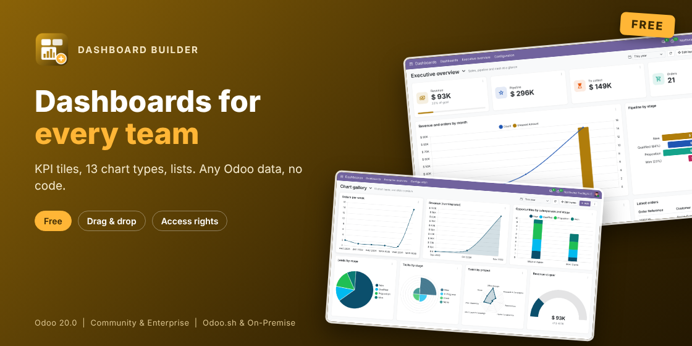

# Dashboard Builder: KPI Tiles, Charts & Lists (Odoo 20.0)

Build dashboards from any Odoo data, without writing code. Free, for Community and Enterprise.

- **KPI tiles** with the change against the previous period and a goal.
- **13 chart types and lists**: bar, horizontal bar, stacked, line, area, pie, doughnut, polar area, radar, scatter, funnel, gauge. Switch type in one click.
- **Any model**: filters, two measures, series, running totals, top N and Others.
- **Period filter** with 22 presets and custom dates.
- **Drag and resize** layout, copy and move items between dashboards.
- **Click a chart** to open its records. CSV and image export, auto refresh.
- **Access rights respected**: figures are read as each user, with Odoo's record rules.

## Install

1. Copy `novator_dashboard` into your addons path and install **Dashboard Builder**.
2. Open the Dashboards app: a sample dashboard is there.
3. Click Add, pick a tile, chart or list, choose the model, measure and group by.

## More

- Odoo Apps Store: https://apps.odoo.com/apps/modules/20.0/novator_dashboard
- AI with your own key, drill-down, TV mode, SQL and spreadsheet items, email digests, ready-made dashboards: [Dashboard Builder Pro](https://apps.odoo.com/apps/modules/20.0/novator_dashboard_pro)
- Support: support@novator.co, https://www.novator.co

## License

GNU Lesser General Public License v3 (LGPL-3). (c) Novator Technologies.
